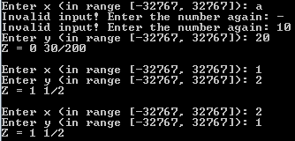
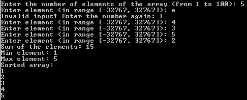

# 🖥️ x86 Assembly for DOS

A set of 16-bit real-mode programs in MASM/TASM syntax: from copying a byte array in reverse order to an interactive matrix search, plus a macro library that the later programs were refactored into. Everything talks to the user through plain DOS services — **INT 21h/0Ah** buffered input, **INT 21h/09h** strings and **INT 29h** fast character output — with careful validation of every number the user types.

🎓 System Software course, Igor Sikorsky Kyiv Polytechnic Institute (KPI), 2nd year, spring 2024.

## 📦 Programs

| File | What it does |
|---|---|
| `array-reverse.asm` | Copies `SOURCE DB 10, 20, 30, 40` into `DEST` in reverse order; no I/O, meant to be stepped through in a debugger |
| `signed-io.asm` | Reads an integer in `[-999, 999]`, subtracts 32 and prints the signed result |
| `piecewise-function.asm` | Reads `x` and `y`, evaluates a piecewise function and prints a fraction as `whole remainder/divisor` |
| `array-stats-sort.asm` | Reads up to 100 numbers, prints their sum, minimum, maximum and the sorted array |
| `matrix-search.asm` | Reads a matrix up to 20×20 and offers a menu: print it, find all positions of a value, or enter a new one |
| `macros/` | The signed I/O, piecewise function and matrix programs rewritten with macros; `macros.inc` is the shared library |

## ⚙️ How it works

**Number input.** `INPUTNUMBER` reads a line with INT 21h/0Ah, checks for a leading `-` and converts digit by digit (`AX = AX * 10 + digit`). Any non-digit, an empty line, a `MUL` result that spills into `DX`, a carry on the addition or a value outside `[mininput, maxinput]` prints an error and asks again. The limits live in memory, so the same routine reads matrix sizes (`1..20`), array lengths (`1..100`) and elements (`-32767..32767`).

**Number output.** `PRINTNUMBER` prints a minus sign and negates if needed, then divides by 10 pushing the remainders onto the stack and pops them back in the right order through INT 29h.

**Piecewise function.**

```
      (x + y) / (xy)   if x > 0,  y > 0
Z =   25y              if x < 0,  y < 0
      6x               if x > 10, y = 0
      1                otherwise
```

Every branch checks for overflow before printing: the 32-bit result of `MUL`/`IMUL` must fit into a signed word (`DX = 0` and `AX ≤ 32767` for positive results, `DX = -1` and `AX ≥ 8000h` for negative ones). The division prints the integer part and the remainder as a fraction, e.g. `Z = 1 1/2`.

**Arrays.** The sum is accumulated in 32 bits (`CWD` + `ADD`/`ADC`) and reported as an overflow only if the final value does not fit into a word. Minimum and maximum are a single linear pass with signed comparisons; the array is sorted in place with an exchange sort.

**Matrix.** Elements are stored row-major in `matrix DW 400 DUP(0)`. The address of `[i][j]` is `2·i·columns + 2·j`, computed into `BX` and `DI` and used as `matrix[BX][DI]`. The search walks the whole matrix and prints 1-based `row column` pairs for every match, or a "not found" message.

**Macros.** `INPUTNUMBER`, `PRINTNUMBER` (with the value as a parameter), `INPUTMATRIX`, `PRINTMATRIX` and `FINDCOORDS` live in `macros/macros.inc`. All jump targets are declared `LOCAL`, so each expansion gets unique labels (`??0000`, `??0001`, …) and macros can be nested — `INPUTMATRIX` expands `INPUTNUMBER` three times. Because expanded bodies get long, loops that jump back over a nested expansion go through short `JMP` trampolines so every conditional jump stays within the 8086 ±128-byte range.

## 💬 Sample session

Matrix search, as recorded in DOS:

```
Enter the number of rows (from 1 to 20): 2
Enter the number of columns (from 1 to 20): 2
Enter element with row = 1, column = 1 (in range [-32767, 32767]): 1
Enter element with row = 1, column = 2 (in range [-32767, 32767]): 2
Enter element with row = 2, column = 1 (in range [-32767, 32767]): 2
Enter element with row = 2, column = 2 (in range [-32767, 32767]): 1
Matrix:
1       2
2       1
What do you want to do? [1-print,2-search, other digit-enter another matrix]: 2
Enter the value to search for (in range [-32767, 32767]): 1
Coordinates of all corresponding elements:
1 1
2 2
What do you want to do? [1-print,2-search, other digit-enter another matrix]: 2
Enter the value to search for (in range [-32767, 32767]): 0
The element was not found!
```

Piecewise function and array statistics:

<p>
  
  
</p>

## 🛠️ Building and running

The sources assemble with [JWasm](https://github.com/Baron-von-Riedesel/JWasm), a free MASM-compatible assembler that writes DOS `.EXE` files directly (`-mz`), and run in [DOSBox](https://www.dosbox.com/).

```bash
git clone https://github.com/pgerasymchuk/x86-assembly-dos.git
cd x86-assembly-dos
make                    # build/REVERSE.EXE, SIGNIO.EXE, FUNCXY.EXE, ARRSORT.EXE, MATRIX.EXE,
                        #       SIGNIOM.EXE, FUNCXYM.EXE, MATRIXM.EXE
dosbox build            # then type e.g. MATRIX.EXE
```

Use `make ASM=/path/to/jwasm` if JWasm is not on `PATH`.

With the classic Turbo Assembler toolchain, `make dos-src` copies the sources into `build/` under 8.3 names (together with `MACROS.INC`); inside DOSBox:

```
tasm /zi MATRIX.ASM
tlink /v MATRIX.OBJ
MATRIX.EXE
```

`REVERSE.EXE` has no output — load it with `td REVERSE.EXE`, step with F7 and watch `DEST` at `DS:0004` change from `3F 3F 3F 3F` to `28 1E 14 0A`.

## 🗂 Project structure

```
├── array-reverse.asm         byte array copied in reverse order
├── signed-io.asm             signed input, arithmetic, output
├── piecewise-function.asm    branching with overflow checks
├── array-stats-sort.asm      sum, min, max, sorting
├── matrix-search.asm         2D array input, print and search menu
├── macros/                   macro versions and the macros.inc library
├── docs/                     screenshots of sample sessions
└── Makefile                  JWasm build into build/
```

## 🧰 Tech stack

- x86 16-bit assembly (8086 instruction set), MASM/TASM syntax, `.EXE` with separate stack, data and code segments
- DOS INT 21h (functions 02h, 09h, 0Ah), INT 29h, BIOS INT 10h
- JWasm / Turbo Assembler, Turbo Debugger, DOSBox, GNU Make
